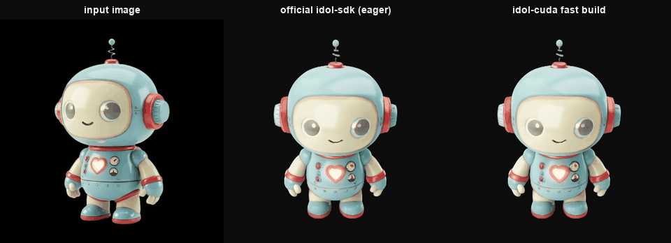
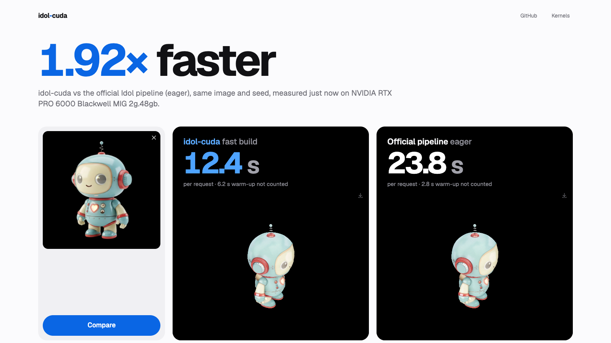
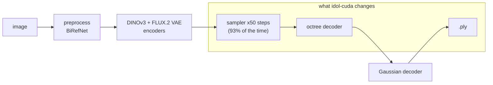
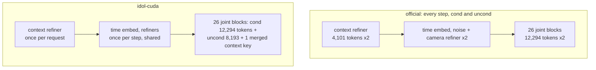
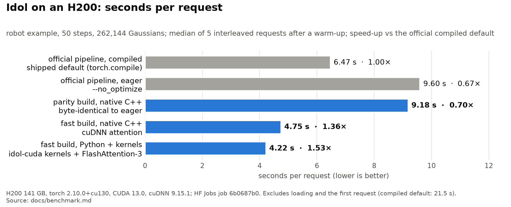
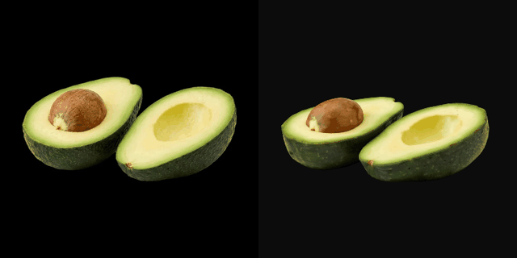
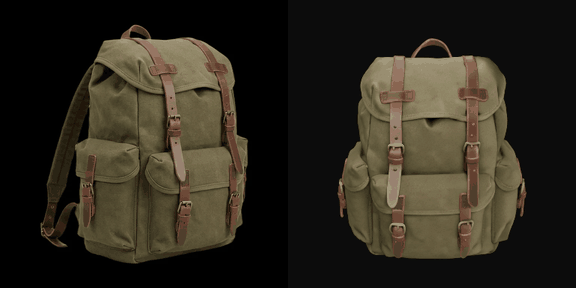

<h1 align="center">idol-cuda</h1>

<p align="center">
  <b>One image in, a 3D Gaussian splat out, 1.5x faster than the official pipeline on an H200.</b><br>
  An unofficial CUDA port of Speri Labs' Idol: a restructured sampler, fused kernels, and a byte-identical parity build.
</p>

<p align="center">
  
  <a href="https://huggingface.co/speridlabs/idol"></a>
  <a href="https://huggingface.co/kernels/suvadityamuk/idol-cuda"></a>
  <a href="https://huggingface.co/spaces/suvadityamuk/idol-cuda-demo"></a>
  
</p>

<p align="center">
  
</p>

```bash
python scripts/infer.py photo.jpg -o photo.ply
```

You get `photo.ply`, a standard 3D Gaussian splat file (262,144 Gaussians by default), including the sides the photo
never showed. The renders on this page are from gsplat, and Gradio's `Model3D` displays the files (as in the Space).

## Why

[Idol](https://huggingface.co/speridlabs/idol) turns one picture of an object into 3D Gaussians. Its official
pipeline ([idol-sdk](https://github.com/speridlabs/idol-sdk)) is already compiled with `torch.compile` by default.
idol-cuda keeps the official pre-processing, encoders and decoders and makes the sampler, which is 93% of a request,
do less work:

| on an H200, 50 steps, 262,144 Gaussians | seconds per request | speed-up |
|---|---|---|
| official pipeline, compiled (default) | 6.47 | 1.00x |
| official pipeline, eager (`--no_optimize`) | 9.60 | 0.67x |
| **idol-cuda fast build** (kernels + FlashAttention-3) | **4.22** | **1.53x** |
| idol-cuda parity build (byte-identical to eager) | 9.15 | 0.71x |

Median of 5 interleaved requests in one session, after a warm-up (the compiled default's first request takes 21.5 s
because of compilation). Full tables, the 1M-Gaussian and avocado configs, and memory: [docs/benchmark.md](docs/benchmark.md).

Try it without installing anything in the [Space](https://huggingface.co/spaces/suvadityamuk/idol-cuda-demo): it runs
the same image through the official pipeline and the fast build and shows both times and both splats.

<p align="center">
  <a href="https://huggingface.co/spaces/suvadityamuk/idol-cuda-demo"></a>
</p>

## Install

You need Linux x86_64, an NVIDIA GPU (compute capability 8.0 or newer; tested on an H200), Python 3.12, and a Hugging
Face account that has accepted the licences of the two gated image encoders Idol uses,
[DINOv3](https://huggingface.co/facebook/dinov3-vith16plus-pretrain-lvd1689m) and
[FLUX.2-dev](https://huggingface.co/black-forest-labs/FLUX.2-dev) (only its VAE is downloaded).

```bash
git clone https://github.com/suvadityamuk/idol-cuda && cd idol-cuda
python -m venv .venv && . .venv/bin/activate
pip install -r requirements.txt        # torch 2.10.0+cu130, idol-sdk 8db7003, kernels 0.19, pinned
hf auth login                          # or export HF_TOKEN=...
```

The first run downloads Idol's weights (about 3 GB), the two encoders, the idol-cuda kernels for your torch/CUDA
from [suvadityamuk/idol-cuda](https://huggingface.co/kernels/suvadityamuk/idol-cuda), and on Hopper GPUs FlashAttention-3
from [kernels-community/flash-attn3](https://huggingface.co/kernels-community/flash-attn3).

## Usage

```bash
python scripts/infer.py photo.jpg -o photo.ply                     # fast build, real-photo mode
python scripts/infer.py render.png -o render.ply --mode synthetic  # renders and generated images: tighter crop
python scripts/infer.py photo.jpg -o photo.ply --seed 7            # another take on the same image
python scripts/infer.py photo.jpg -o photo.ply --gaussians 1048576 --steps 50
python scripts/infer.py photo.jpg -o photo.ply --turntable         # also photo.gif (needs `pip install gsplat`)
python scripts/infer.py photo.jpg -o photo.ply --warmup            # time a second request, without warm-up
python scripts/infer.py photo.jpg -o photo.ply --local-kernels kernel   # kernels from a local kernel-builder build
python scripts/infer.py photo.jpg -o photo.ply --build parity      # byte-identical to the official eager pipeline*
python scripts/infer.py photo.jpg -o photo.ply --build reference   # the official pipeline as shipped (--eager too)
```

\* on the tested setup; see [Parity](#parity).

It prints the device, the build, where the kernels came from, the attention backend, per-stage times and the total.
A run on the H200 (robot example, with `--warmup` so the timed request excludes the one-off warm-up; the 165 s load
was a cold first read of the weights):

```
device:  NVIDIA H200 (sm_90), torch 2.10.0+cu130, CUDA 13.0
build:   fast (restructured sampler + idol-cuda kernels)
kernels: kernel-builder build at /work/kb
attention: FlashAttention-3 (kernels-community/flash-attn3)
load:    164.8 s (weights, encoders, kernels)
warm-up: 6.28 s (not counted below)
  preprocess     0.160 s
  encoders       0.078 s
  sampling       3.900 s
  octree         0.036 s
  gs_decoder     0.042 s
  to_gaussians   0.000 s
request: 4.22 s
export:  0.08 s -> /work/o/robot_fast.ply, /work/o/robot_fast_input.png, /work/o/robot_fast_camera.json
total:   186.9 s wall (including start-up and loading)
```

If FlashAttention-3 cannot be loaded (non-Hopper GPU, no network), it says so and uses cuDNN attention. Without a CUDA
GPU, on an unsupported architecture, or without access to the gated encoders it stops with an explanation.

Other entry points: `scripts/run_kernels.py` (the same fast and parity builds, older flags),
`scripts/run_native.sh` (the whole request in one libtorch C++ process, see below).

## How it works



Inside the sampler, per request:



- **Structure.** The context stream depends only on the image, so it is computed once per request. The time
  embedding, adaLN modulation and the noise and camera refiners are computed once per step and shared by both guidance
  passes, whose rows are packed into one matrix.
- **One context token in the unconditional pass.** Its 4,101 context tokens are identical, so attention runs over the
  other 8,193 keys and the context key is merged exactly with multiplicity 4,101 through the log-sum-exp
  (`merge_extra_key`). This alone is 1.27x per step.
- **Fused kernels** ([kernel/](kernel/), published as [suvadityamuk/idol-cuda](https://huggingface.co/kernels/suvadityamuk/idol-cuda)):
  `add_ln_mod` (residual + gate + LayerNorm + adaLN + the next layer's LayerNorm in one pass), `rope_rms_qk` (RePo
  angles + RoPE + q/k RMSNorm), `linear_gelu` (GELU in the cuBLASLt epilogue), `rms_heads`, and `gaussians_ply`
  (Gaussian activations written straight into PLY columns).
- **FlashAttention-3** on Hopper instead of cuDNN attention: 1.17x per step.
- **Decode side.** A loop-free octree sampler (0.035 s instead of about 0.2 s, no `.item()` syncs).

A fast step is 77-79 ms against 125 ms for the compiled default. Everything tried, including what was rejected
(CUDA graphs, FP8 attention, FlashAttention-2), is in [docs/ab-log.md](docs/ab-log.md); the profile that motivated it
is in [docs/profile.md](docs/profile.md).

## Optimizations: where the time went

Sampling is 93% of a request with the official compiled pipeline (6.1 s of 6.6 s), and the GPU is busy 99% of that
time, so the time had to come out of the work itself, not out of launch overhead. Per sampling step (both guidance
passes), robot, 262,144 Gaussians, H200, each build measured interleaved in one process:

| step | what changed | ms per step | saved per step | error added |
|---|---|---:|---:|---|
| official, eager | | 185.8 | | |
| official, compiled (the baseline) | | 125.0 | | |
| 1 + 2 | **Stop recomputing.** The context stream runs once per request instead of 100 times; time embedding, noise refiner and camera refiner run once per step instead of twice. **Fused kernels** replace the chains Inductor emits: residual + LayerNorm + modulation in one pass, RePo angles + RoPE + q/k RMSNorm in one pass, bias + GELU in the GEMM epilogue instead of a second pass over a 24,588 x 4,096 matrix | 113.5 | 11.5 (1.09x) | per call closer to the eager official output than the compiled default is |
| 3 | **One context token in the unconditional pass.** Its 4,101 context tokens are identical (zero image features), so attention sees one token with weight 4,101. The unconditional pass attends over 8,193 keys instead of 12,294, in 26 layers | 89.7 | 23.8 (1.27x) | per-call error unchanged to 2 digits; final latent rel. 1.57e-2 against 1.18e-2 (robot) |
| 4 | **FlashAttention-3** (Hopper) instead of cuDNN attention, which was 65% of sampling | 77.4 | 12.3 (1.17x) | per-call error equal or smaller; final latent rel. 6.95e-3 (robot), 5.63e-3 (avocado) |

Over 50 steps that is 125.0 → 77.4 ms, 1.62x, or about 2.4 s off a 6.6 s request: 0.6 s from reuse and fusion,
1.2 s from the one-token unconditional pass, 0.6 s from FlashAttention-3. On the avocado FlashAttention-3 gives
79.1 against 88.8 ms (1.12x).

Outside the sampler:

- **Octree sampling**: 0.035 s instead of 0.11-0.21 s. The official loop syncs with `.item()` per count (GPU busy
  12% of its wall time); the replacement draws one random number per level and has no loop.
- **Gaussian activations and `.ply` columns** are written by one kernel and the file in one write: about 0.1 s
  against 0.1-0.2 s.

Tried and dropped, with the measurement:

| idea | result |
|---|---|
| FlashAttention-2 (PyTorch's and flash-attn 2.8.3) | 106.6 and 106.9 ms per step against 89.7 with cuDNN: slower |
| CUDA graph over a whole step | 4.655 against 4.471 s for 50 steps: 4% slower (the GPU was already 99% busy) |
| FP8 attention | 71.7 against 75.7 ms per step, but the final latent moved by rel. 0.287: rejected on quality |

## Benchmark

<picture>
  <source media="(prefers-color-scheme: dark)" srcset="https://raw.githubusercontent.com/suvadityamuk/idol-cuda/main/assets/benchmark-dark.png">
  
</picture>

One HF Jobs H200 session (NVIDIA H200 141 GB, driver 595.112.07, torch 2.10.0+cu130, CUDA 13.0, cuDNN 9.15.1). All
builds were loaded once as long-lived workers, each config got one warm-up request per build, then 5 rounds in an
order that rotates and reverses each round. "Request" is image path in to Gaussians out, CUDA-synced.

| build | robot 262k | avocado 262k | robot 1M | avocado 1M |
|---|---|---|---|---|
| official, compiled (default) | 6.470 s, 1.00x | 6.512 s, 1.00x | 6.750 s, 1.00x | 6.794 s, 1.00x |
| official, eager (`--no_optimize`) | 9.599 s, 0.67x | 9.639 s, 0.68x | 9.894 s, 0.68x | 9.930 s, 0.68x |
| parity, native C++ | 9.184 s, 0.70x | 9.196 s, 0.71x | 9.431 s, 0.72x | 9.504 s, 0.71x |
| parity, Python | 9.147 s, 0.71x | 9.162 s, 0.71x | 9.425 s, 0.72x | 9.458 s, 0.72x |
| **fast, Python + kernels + FA3** | **4.221 s, 1.53x** | **4.234 s, 1.54x** | **4.467 s, 1.51x** | **4.489 s, 1.51x** |
| fast, native C++ (cuDNN) | 4.747 s, 1.36x | 4.767 s, 1.37x | 4.988 s, 1.35x | 5.026 s, 1.35x |

Peak memory is about the same as the official pipeline's (5.08 vs 5.02 GB allocated at 262k). Load time and first
request per build, export time, and min-max ranges: [docs/benchmark.md](docs/benchmark.md). Chart data:
[assets/bench_cuda.json](assets/bench_cuda.json), drawn by `tools/make_charts.py`.

## Quality

The fast build is not byte-identical to the official pipeline; it is held to the official pipeline's own spread,
i.e. how far the official variants (compiled vs eager, flash-attn vs SDPA) are from the eager reference:

- **Rendered views** (gsplat, 8 fixed cameras): within 0.2 dB PSNR of the official variants on every config (robot
  262k: fast 42.58 dB vs compiled 42.76 and flash-attn 42.98 dB, all against eager; SSIM equal to the fourth decimal).
- **Gaussian positions** (Chamfer distance to the eager reference): equal to the official variants' (1.69e-3 vs
  1.68e-3 on robot 262k).
- **Per step**, on the reference's own recorded inputs, the fast sampler is closer to eager than the compiled default
  at every step checked.
- **Outside the spread, on avocado:** the final latent is 1.22x and the predicted camera (field of view, radius)
  about 1.5x further from eager than the compiled default is. The robot is inside on every metric. The spread itself
  rests on one end-to-end sample per official variant.

<p align="center">
  
  
</p>

## Parity

The parity build exists to show that the port is exact before it is fast. On one fixed setup, **HF Jobs H200
(sm_90), driver 595.112.07, CUDA 13.0, cuDNN 9.15.1, torch 2.10.0+cu130, Pillow 13.0.0, idol-sdk 8db7003 with
`ATTN_BACKEND=sdpa`**, its `.ply` and camera JSON are byte-identical (compared with `cmp` / sha256) to those of the
official pipeline in eager mode (`--no_optimize`) on all four configs (robot and avocado, 262,144 and 1,048,576
Gaussians), as a native libtorch C++ binary and as a Python mode. The native binary's regression check
(`scripts/parity_test.sh`) byte-compares 760 to 1,000 intermediate checkpoints per config. The parity builds are
1.04-1.05x faster than eager, from reuse that is bit-equal (context once, shared per-step prefix).

"Byte-identical" is claimed for exactly that setup. On another GPU, driver, CUDA, cuDNN or torch version, cuBLAS and
cuDNN may choose different kernels and the bytes can differ. The official compiled default is not a parity target:
it is not run-to-run deterministic. Details: [docs/parity.md](docs/parity.md).

## Limits and what is untested

- **Tested hardware and software:** one H200 with torch 2.10.0+cu130. The kernel package is built for torch 2.10 to
  2.15 and CUDA 12.6 to 13.4, for compute capabilities 8.0, 8.6, 8.9, 9.0, 10.0 and 12.0 (CUDA 12.6 variants stop at
  9.0); only the torch 2.10 + CUDA 13.0 variant on sm_90 ran the full pipeline and the 44 kernel tests on a GPU.
  The torch 2.10 + CUDA 12.8 variant also passed the 44 kernel tests on sm_120 (the Space's ZeroGPU slice of an
  RTX PRO 6000 Blackwell); the full pipeline has not been timed there outside the Space. Everything else (sm_80,
  sm_86, sm_89, sm_100, the other torch/CUDA variants) is built but untested.
- **FlashAttention-3 is Hopper-only.** Elsewhere the fast build uses cuDNN attention, and its speed-up has not been
  measured outside the H200 (the Space measures it live on its own GPU).
- **The native C++ fast build** cannot load the FlashAttention-3 Hub kernel (it binds libpython symbols), so it runs
  cuDNN attention and is 1.35-1.37x instead of 1.51-1.54x.
- **The closeness misses** on avocado listed above.
- `kernels benchmark` and the package's `benchmarks/benchmark.py` have not been run.

## FAQ

<details>
<summary><b>Do I need an H200?</b></summary>

No. Any NVIDIA GPU with compute capability 8.0 or newer should run it (kernels are built for sm_80 to sm_120), but
only the H200 was measured. Idol itself needs about 5 GB of GPU memory at 262,144 Gaussians.
</details>

<details>
<summary><b>Is the output the same as the official pipeline's?</b></summary>

The fast build's is close, not identical: about as close to the official eager output as the official compiled
output is (see Quality). The parity build's is byte-identical on the tested setup. Same seed means the same starting
noise; the fast build's octree sampler draws its random numbers differently.
</details>

<details>
<summary><b>Why is the Space slower than the H200 numbers?</b></summary>

The Space runs on ZeroGPU, half of an NVIDIA RTX PRO 6000 Blackwell. FlashAttention-3 does not load there (it is
built for Hopper), and ZeroGPU's documentation lists `torch.compile` as unsupported (the official default's first
request also spends about 21 s compiling, which every new GPU worker would repeat). So the Space compares the fast
build with cuDNN attention against the official pipeline in eager mode, and shows the H200 numbers separately.
</details>

<details>
<summary><b>Why do I need a Hugging Face token?</b></summary>

Idol encodes the image with DINOv3 and the FLUX.2-dev VAE, which are gated. Accept their licences on the Hub with your
account and log in. Nothing else is uploaded anywhere; the request runs on your GPU.
</details>

<details>
<summary><b>Can I use the kernels on their own?</b></summary>

Yes: `get_kernel("suvadityamuk/idol-cuda", version=1, trust_remote_code=True)`. The ops and their contracts are listed
on the [kernel card](https://huggingface.co/kernels/suvadityamuk/idol-cuda). They are specific to Idol's shapes (width 1024,
head dimension 64).
</details>

## Development and reproduction

| path | what |
|---|---|
| `fast/` | Python fast build: `model.py` (sampler), `pipeline.py` (whole request), `parity.py`, `ops.py` (kernel loader), `runner.py` (checks, timing) |
| `native/` | libtorch C++ binary: the parity port and the fast build, plus a `--serve` benchmark mode |
| `kernel/` | kernel-builder package (edition 6): CUDA sources, torch binding, 44 tests, `benchmarks/benchmark.py`, CARD.md |
| `scripts/` | `infer.py`, `run_kernels.py`, `run_native.sh`, `parity_test.sh` (exits non-zero on the first differing byte) |
| `tools/` | reference runner and dumper, comparer, A/B harness, closeness, benchmark driver, profiles, renderer, turntables, charts |
| `jobs/` | the HF Jobs scripts that produced every number (`launch.sh` takes your own bucket in `IDOL_BUCKET`) |
| `space/` | the Gradio Space (`assemble.sh` builds the Space repository, `test_app.py` tests its logic) |
| `docs/` | profile, A/B log, benchmark, parity |
| `logs/` | small raw outputs the docs cite (benchmark JSON lines, closeness and render JSON) |

```bash
# kernels: build with kernel-builder (Nix), test on a GPU
cd kernel && kernel-builder build-and-copy -L . && IDOL_KERNEL_LOCAL_PATH=$PWD python -m pytest tests
# native binary (needs nvcc 13, CMake >= 3.24, zlib headers); builds itself on first use
scripts/run_native.sh --image photo.webp --mode real --out outputs           # fast
scripts/run_native.sh --parity --image photo.webp --mode real --out outputs  # parity
# parity regression check against reference dumps from tools/ref_run.py
scripts/parity_test.sh REF_DIR OUT_DIR
# the benchmark
python tools/bench.py --help
```

The full write-up of the port, with every number and what was and was not verified, is [REPORT.md](REPORT.md).

## Credits

- [Idol](https://huggingface.co/speridlabs/idol) and [idol-sdk](https://github.com/speridlabs/idol-sdk) by Speri
  Labs (Apache-2.0). This port reuses idol-sdk's modules and is derived from its code; see [NOTICE](NOTICE). It is not
  affiliated with Speri Labs.
- Image encoders: [DINOv3](https://huggingface.co/facebook/dinov3-vith16plus-pretrain-lvd1689m) (Meta) and the
  [FLUX.2-dev](https://huggingface.co/black-forest-labs/FLUX.2-dev) VAE (Black Forest Labs), gated under their own
  licences.
- [FlashAttention-3](https://huggingface.co/kernels-community/flash-attn3) via Hugging Face
  [kernels](https://github.com/huggingface/kernels); packaging with kernel-builder.
- [gsplat](https://github.com/nerfstudio-project/gsplat) for the renders; example images from idol-sdk's
  `demo/examples` (Apache-2.0).
- README layout after [idol-mlx](https://github.com/cfahlgren1/idol-mlx).

Licence: Apache-2.0 ([LICENSE](LICENSE)).
